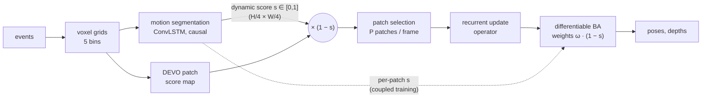
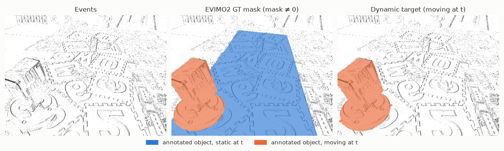

<h1 align="center">MADEVO — Motion-Aware Deep Event Visual Odometry</h1>

<p align="center">
  <a href="#idea"><strong>Idea</strong></a> |
  <a href="#how-devo-works-and-where-the-score-goes"><strong>Method</strong></a> |
  <a href="#setup"><strong>Setup</strong></a> |
  <a href="#running-experiments"><strong>Running experiments</strong></a> |
  <a href="#status-and-known-issues"><strong>Status</strong></a> |
  <a href="#what-changed-in-devo"><strong>What changed in DEVO</strong></a>
</p>

Code from my research internship at IPAL (CNRS / NUS), Singapore, 2026. Work in progress.

> The code base was rebuilt and audited after the internship. The numbers from the
> internship report are being re-run (several evaluation bugs were found and fixed, see
> [Status](#status-and-known-issues)), so there are no results here yet.

## Idea

[DEVO](https://github.com/tum-vision/DEVO) is a learned event-only visual odometry. It
assumes a **static scene**: its differentiable bundle adjustment (BA) reprojects every
tracked patch under a single camera motion, so events fired by moving objects pull the
trajectory off. The target application is an event-camera-only drone or robot guiding
visually impaired people, i.e. scenes full of pedestrians.

The idea is to add a **motion segmentation** (MS) module to DEVO, in the spirit of
DynaSLAM. A causal ConvLSTM predicts, from the event voxel grids, a "dynamic" score per cell
at the resolution of DEVO's patch score map (H/4 × W/4). This score is used to keep patches
off moving objects and to down-weight them in the BA.

## How DEVO works, and where the score goes

DEVO's pipeline: events → voxel grids (5 bins) → patch score map → selection of P = 80
patches per frame → recurrent update operator (predicts patch correspondences and
confidence weights `ω`) → differentiable BA weighted by `ω` → poses and depths.



The score enters DEVO at two points:

1. **Patch selection.** The score map is multiplied by `1 − s` before patches are sampled,
   so cells on moving objects are rarely selected (`devo/enet.py`, `Patchifier`). This is
   the only injection point at inference.
2. **Bundle adjustment.** During coupled training, `s` is sampled at each patch centre and
   scales the BA weights `ω` by `1 − s` (`devo/ba.py`), so the pose loss back-propagates
   into the segmentation network.

With no score (`dyn_score=None`), DEVO behaves exactly as upstream.

## Methods compared

| | Method | How the segmenter is trained | Config |
|---|---|---|---|
| M0 | DEVO + **oracle** mask (upper bound) | — (GT mask injected) | `configs/eval/evimo2.yaml`, method `oracle` |
| M1 | **Decoupled**: segmenter alone, DEVO untouched | GT masks | `configs/ms/v4_evimo2.yaml` |
| M2 | **Coupled, supervised** | pose loss + GT masks | `configs/coupled/m2_evimo2.yaml` |
| M3 | **Coupled, self-supervised** | pose loss + BA residuals (patches above median + 3·MAD labelled dynamic) | `configs/coupled/m3_evimo2.yaml` |

Everything starts from the official DEVO weights. Coupled runs: 40k steps, DEVO frozen for
the first 10k. 5 seeds per configuration.

### What counts as "dynamic" on EVIMO2



EVIMO2 masks segment every object tracked by VICON, **static decor included**: on the
training split, 61 % of the score-map cells are "dynamic" under the raw mask
(`mask != 0`), but only 2 % belong to an object that actually moves at that instant.

So the GT is rebuilt from the VICON poses (`ms_model/motion.py`): an object is dynamic at
time *t* only if it moves more than 1 cm from its median position within a 0.2 s window
around *t*. Details and the measurements behind these thresholds:
[`docs/mask_motion.md`](docs/mask_motion.md). The raw-mask definition used during the
internship is kept as an ablation (`configs/*/*_all.yaml`). The figure comes from
`scripts/plot_mask_definition.py`.

## Setup

Python 3.11, PyTorch 2.4.1, CUDA 11.8, one conda env `madevo` (installs `devo`, `ms_model`
and `utils`).

GPU machine (compiles the CUDA extensions `cuda_corr`, `cuda_ba`, `lietorch_backends`):

```bash
mamba env create -f environment.yml
conda activate madevo
pip install -e . --no-build-isolation
# without a visible GPU: TORCH_CUDA_ARCH_LIST="8.0;8.6;9.0" pip install -e . --no-build-isolation
# Eigen missing: bash scripts/download/download_eigen.sh (or set EIGEN_INCLUDE_DIR)
```

CPU-only machine (tests and dry runs; anything that runs DEVO needs a GPU):

```bash
mamba env create -f environment-cpu.yml
conda activate madevo
MADEVO_SKIP_CUDA_EXT=1 pip install -e . --no-build-isolation
pytest
```

Weights and data (git-ignored; `MADEVO_DATASETS` / `MADEVO_PRETRAINED` to move them, see
[`scripts/download/README.md`](scripts/download/README.md)):

```bash
bash scripts/download/download_devo_weights.sh   # pretrained/DEVO.pth
bash scripts/download/download_evimo2.sh         # datasets/evimo2/
```

On a fresh GPU server, `scripts/setup_server.sh` does all of the above, and
`jobs/smoke_gpu.sh` runs the whole chain on 2 scenes.

## Running experiments

One job = one run = one seed (`jobs/*.sh`). Launchers run a job over several seeds in tmux
or as a Slurm array. Hyper-parameters are in YAML (`configs/`), overridable with
`--set key=value`; `--dry-run` prints the commands without running them.

```bash
# 1. motion segmentation alone (M1, and init of M2/M3)
launch/tmux.sh --seeds 1-5 jobs/train_ms.sh configs/ms/v4_evimo2.yaml

# 2. coupled training, each seed starts from the MS run of the same seed
launch/tmux.sh --seeds 1-5 jobs/train_coupled.sh configs/coupled/m2_evimo2.yaml
launch/tmux.sh --seeds 1-5 jobs/train_coupled.sh configs/coupled/m3_evimo2.yaml

# 3. table (vanilla, oracle, M1, M2, M3) on the 8 EVIMO2 eval sequences
launch/tmux.sh --seeds 1-5 jobs/eval_table.sh configs/eval/evimo2.yaml

# 4. mean ± std over seeds
python tools/aggregate_seeds.py evals_out/evimo2/evimo2/<launch_id>
```

The whole campaign in one command: `launch/campaign_evimo2.sh`. On Slurm:
`launch/slurm.sh --profile gpu_train --seeds 1-5 jobs/...`. Runs resume from their last
checkpoint.

Notes:
- Outputs go to `runs/` and `evals_out/`; each eval writes a `manifest.yaml` with the
  checkpoint behind every row.
- The eval refuses to compare an oracle and a model trained with a different mask
  definition.
- Ablations: capacity (`*_large.yaml`), coupled from scratch (`*_scratch.yaml`), raw masks
  (`*_all.yaml`).
- Logging with wandb (`WANDB_MODE=offline` without an account); project and paths in
  `paths.env` (copy `paths.env.example`).

## Status and known issues

- **No results yet**: the EVIMO2 campaign (5 seeds × M0–M3 + vanilla) has to be run on the
  lab GPU servers. The internship report's numbers are not valid: they are affected by the
  bugs below and used the raw mask definition.
- Bugs fixed since the internship: EVIMO2 eval files read at 260 × 346 instead of
  480 × 640, mean ATE also averaging two aggregate keys, and 33 % of the converted eval
  masks paired with the wrong timestamps.
- The GT "dynamic" label comes from VICON trajectories, not hand annotation; at the chosen
  threshold 66 % of training frames contain no moving object.
- EVIMO2 only for now; cross-dataset evaluation is set up but postponed.
- `best_iou.pt` is selected on the eval sequences (no separate validation split in the
  main campaign).
- A full GPU run with the PyTorch 2.4 environment is still to be validated.

## Repository layout

```
devo/            DEVO (upstream) + the injection points (enet.py, ba.py, devo.py)
ms_model/        motion segmentation: ConvLSTM, datasets, motion filter, mask providers
train_coupled.py joint training of the segmenter and DEVO (M2, M3)
evals/           unified evaluation (eval_table.py) and EVIMO2 mask providers
configs/         ms/, coupled/, eval/ (config/ = DEVO's own VO parameters)
jobs/ launch/    jobs and tmux / Slurm launchers
tools/           config resolution, seed aggregation, mask statistics, checks
scripts/         downloads, preprocessing, figures
docs/            design notes
tests/           CPU tests on synthetic EVIMO sequences
```

`train.py` and `evals/eval_evs/` per-dataset scripts come from upstream DEVO and are not
used here.

### What changed in DEVO

The history starts with DEVO as released upstream (commit `db22f2b` =
tum-vision/DEVO@93801a4), so every change to DEVO's core is visible with:

```bash
git diff db22f2b -- devo/
```

Three files carry the method (`enet.py`, `ba.py`, `devo.py`); four others are a mechanical
port of the CUDA extensions to PyTorch 2.x. Everything else lives outside `devo/`.

## License

Fork of [DEVO](https://github.com/tum-vision/DEVO), itself built on
[DPVO](https://github.com/princeton-vl/DPVO), both MIT. Same license here, see
[`LICENSE`](LICENSE).
