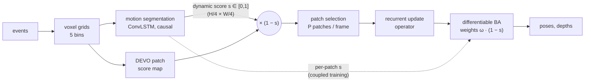

<h1 align="center">MADEVO — Motion-Aware Deep Event Visual Odometry</h1>

<p align="center">
  Arthur Fournier — research internship at IPAL (CNRS / NUS), Singapore, 2026
</p>

<p align="center">
  <a href="#method"><strong>Method</strong></a> |
  <a href="#setup"><strong>Setup</strong></a> |
  <a href="#running-experiments"><strong>Running experiments</strong></a> |
  <a href="#results"><strong>Results</strong></a> |
  <a href="#what-changed-in-devo"><strong>What changed in DEVO</strong></a> |
  <a href="#citation"><strong>Citation</strong></a>
</p>

> **Status: work in progress.** The code base has been rebuilt and audited after the
> internship. Every number from the internship report is being re-run (several evaluation
> bugs were found and fixed, see [Limitations](#limitations-and-known-issues)), so this
> README does not report results yet.

Learned event-based visual odometry assumes a **static scene**. In
[DEVO](https://github.com/tum-vision/DEVO) (Klenk et al., 3DV 2024), the differentiable
bundle adjustment reprojects every tracked patch under a single camera motion, so events
fired by independently moving objects pull the trajectory off. That is a problem for the
application this work targets: an event-camera-only drone or robot guiding visually impaired
people through spaces full of pedestrians.

MADEVO adds a **motion segmentation** module to DEVO, in the spirit of DynaSLAM but inside a
learned event-only VO. A causal ConvLSTM predicts, from event voxel grids, a per-cell
"dynamic" score at the resolution of DEVO's patch score map (H/4 × W/4). The score keeps
patches off moving objects and down-weights them in the bundle adjustment. The segmenter
can be trained on its own, jointly with DEVO under ground-truth masks, or **jointly with
DEVO without any mask annotation**, using the bundle adjustment residuals as supervision.

## Method



The dynamic score enters DEVO at two points:

1. **Patch selection.** The score map is multiplied by `1 − s` before patches are sampled,
   so cells on moving objects are rarely selected (`devo/enet.py`, `Patchifier`). This is
   the only injection point at inference, for every method below.
2. **Bundle adjustment.** During coupled training, `s` is sampled at each patch centre and
   scales the confidence weights `ω` of the differentiable BA by `1 − s` (`devo/ba.py`).
   The pose loss therefore back-propagates into the segmentation network.

With no score (`dyn_score=None`), DEVO behaves exactly as upstream.

| Milestone | Method | Segmenter training signal | Config |
|---|---|---|---|
| M0 | DEVO + **oracle** mask (upper bound) | — (ground-truth mask injected) | `configs/eval/evimo2.yaml`, method `oracle` |
| M1 | **Decoupled**: segmenter trained alone, DEVO untouched | GT masks | `configs/ms/v4_evimo2.yaml` |
| M2 | **Coupled, supervised**: segmenter + DEVO trained jointly | pose loss + GT masks | `configs/coupled/m2_evimo2.yaml` |
| M3 | **Coupled, self-supervised** | pose loss + BA residuals (patches above median + 3·MAD are labelled dynamic) | `configs/coupled/m3_evimo2.yaml` |

All methods start from the official DEVO weights. Coupled runs train for 40k steps, with
DEVO frozen for the first 10k. Each configuration is trained and evaluated with 5 seeds.

### What counts as "dynamic" on EVIMO2

<p align="center">
  
</p>

[EVIMO2](https://better-flow.github.io/evimo/) masks segment **every object tracked by
VICON**, static decor included: on the training split, 61 % of the score-map cells are
"dynamic" under the raw mask (`mask != 0`), but only 2 % belong to an object that is
actually moving at that instant. Training on the raw mask teaches the network to recognise
annotated objects rather than motion, and makes the "oracle" hide mostly static scenery.

MADEVO rebuilds each object's world trajectory from the VICON poses
(`ms_model/motion.py`) and labels an object dynamic at time *t* only if it moves more than
1 cm from its median position within a 0.2 s window around *t*. The choice of mode, threshold,
window and loss weighting, measured on the training split, is documented in
[`docs/mask_motion.md`](docs/mask_motion.md). The raw-mask definition used during the
internship is kept as an ablation (`configs/*/*_all.yaml`).

The figure is produced by `scripts/plot_mask_definition.py` from EVIMO2 data.

## Setup

Tested on Ubuntu 22.04 / WSL2 with Python 3.11, PyTorch 2.4.1 and CUDA 11.8. A single conda
environment, `madevo`, installs `devo`, `ms_model` and `utils` in one command.

```bash
git clone https://github.com/arthurfou/MADEVO.git
cd MADEVO
```

### GPU machine (training and evaluation)

`environment.yml` provides PyTorch 2.4.1+cu118 (Pascal `sm_61` to Hopper `sm_90`), the
toolchain for the three CUDA extensions inherited from DPVO (`cuda_corr`, `cuda_ba`,
`lietorch_backends`) and the Eigen 3.4 headers.

```bash
mamba env create -f environment.yml      # or: conda env create -f environment.yml
conda activate madevo
pip install -e . --no-build-isolation
```

- `--no-build-isolation` is required: building the extensions imports `torch`.
- On a login node without a visible GPU, set the target architectures explicitly, e.g.
  `TORCH_CUDA_ARCH_LIST="8.0;8.6;9.0" pip install -e . --no-build-isolation`.
- If Eigen is not available: `bash scripts/download/download_eigen.sh`, or set
  `EIGEN_INCLUDE_DIR` to an existing Eigen 3.4.

```bash
python -c "import cuda_ba, cuda_corr, lietorch_backends; print('extensions OK')"
python -c "import torch; print(torch.__version__, torch.cuda.is_available())"
```

### CPU-only machine (development, tests, dry runs)

Same environment name, CPU PyTorch, CUDA extensions skipped. Everything that runs DEVO
itself still needs a GPU.

```bash
mamba env create -f environment-cpu.yml
conda activate madevo
MADEVO_SKIP_CUDA_EXT=1 pip install -e . --no-build-isolation
pytest                                    # ~130 tests, a few seconds, no dataset needed
```

### Weights and data

```bash
bash scripts/download/download_devo_weights.sh   # pretrained/DEVO.pth (~40 MB)
bash scripts/download/download_evimo2.sh         # datasets/evimo2/ (~2.4 GB + preprocessing)
```

`datasets/` and `pretrained/` are git-ignored. Set `MADEVO_DATASETS` / `MADEVO_PRETRAINED`
to store them elsewhere. Details and the resulting layout:
[`scripts/download/README.md`](scripts/download/README.md).

## Running experiments

One **job** is one run with one seed (`jobs/*.sh`). Launchers run a job over several seeds,
in tmux sessions or as a Slurm array. Hyper-parameters live in YAML (`configs/`) and can be
overridden with `--set key=value`. `--dry-run` resolves everything and prints the commands
without running anything.

```bash
# 1. motion segmentation alone (M1, and initialisation of M2/M3), 5 seeds
launch/tmux.sh --seeds 1-5 jobs/train_ms.sh configs/ms/v4_evimo2.yaml

# 2. coupled training, each seed initialised from the MS run of the same seed
launch/tmux.sh --seeds 1-5 jobs/train_coupled.sh configs/coupled/m2_evimo2.yaml
launch/tmux.sh --seeds 1-5 jobs/train_coupled.sh configs/coupled/m3_evimo2.yaml

# 3. central table (vanilla, oracle, M1, M2, M3) on the 8 EVIMO2 eval sequences
launch/tmux.sh --seeds 1-5 jobs/eval_table.sh configs/eval/evimo2.yaml

# 4. mean ± std over seeds
python tools/aggregate_seeds.py evals_out/evimo2/evimo2/<launch_id>
```

Same jobs on a Slurm cluster: `launch/slurm.sh --profile gpu_train --seeds 1-5 jobs/...`
(profiles in `launch/profiles/`). Runs resume automatically from their last checkpoint.

- **Outputs**: `runs/<exp>/<launch_id>/seed<N>/` (resolved config, command, git state,
  checkpoints, logs) and `evals_out/<dataset>/<sources>/<launch_id>/seed<N>/`. Each table
  comes with a `manifest.yaml` that records the exact checkpoint behind every row.
- **Consistency guard**: the evaluation refuses to compare an oracle and a trained model
  that use different definitions of the dynamic mask.
- **Ablations**: model capacity (`*_large.yaml`), coupled training from scratch
  (`*_scratch.yaml`), raw EVIMO2 masks (`*_all.yaml`, with `configs/eval/evimo2_all.yaml`).
- **Logging**: all jobs log to [Weights & Biases](https://wandb.ai). Without an account, run
  with `WANDB_MODE=offline`. Copy `paths.env.example` to `paths.env` to set the project,
  entity and output locations.
- **CPU smoke test**: `jobs/train_ms.sh configs/ms/smoke.yaml` trains the segmenter for 2
  epochs on one sequence.

## Results

To be filled in once the evaluation campaign is complete: mean ± std over 5 seeds of the
absolute trajectory error on the 8 EVIMO2 `imo/eval` sequences.

| Method | ATE ↓ | Δ vs DEVO |
|---|---|---|
| DEVO (vanilla) | — | — |
| M0 oracle mask | — | — |
| M1 decoupled | — | — |
| M2 coupled, supervised | — | — |
| M3 coupled, self-supervised | — | — |

The figures in the internship report are **not** valid and should not be quoted: they are
affected by the bugs listed below and use the raw EVIMO2 mask definition.

## Limitations and known issues

- **Mask definition.** The ground-truth "dynamic" label is derived from VICON trajectories
  (see above), not annotated by hand. At the chosen threshold, 66 % of the training frames
  contain no moving object.
- **Single dataset.** Training and evaluation use EVIMO2 (`samsung_mono`, `imo`) only.
  Cross-dataset evaluation is postponed.
- **Validation split.** The segmenter's best checkpoint (`best_iou.pt`) is currently
  selected on the evaluation sequences. A validation split carved from the training
  sequences is planned.
- **Fixed evaluation bugs** (they affect the internship numbers, not this code): the
  resolution of converted EVIMO2 files was read as 260 × 346 instead of 480 × 640, the mean
  ATE also averaged two aggregate keys, and the converted evaluation masks were paired with
  the wrong timestamps across VICON tracking gaps (33 % of them).
- The CUDA extensions build with PyTorch 2.4, but a full GPU run with this environment
  (DEVO forward, BA, VO evaluation) is still being validated.

## Repository structure

```
devo/            DEVO (upstream), with the two injection points (enet.py, ba.py, devo.py)
ms_model/        motion segmentation: ConvLSTM, EVIMO datasets, motion filter, mask providers
train_coupled.py joint training of the segmenter and DEVO (M2, M3)
evals/           unified evaluation (eval_table.py) and EVIMO2 mask providers
configs/         YAML configs: ms/, coupled/, eval/ (config/ holds DEVO's VO parameters)
jobs/ launch/    one job = one run = one seed; tmux and Slurm launchers
tools/           config resolution, seed aggregation, mask statistics
scripts/         downloads, preprocessing, figures
docs/            design notes (definition of the dynamic mask)
tests/           CPU tests on synthetic EVIMO sequences
```

`train.py` (DEVO training on TartanAir) and the per-dataset scripts in `evals/eval_evs/`
come from upstream DEVO. They are kept for completeness but not used here: every
experiment starts from the official DEVO weights. See the
[upstream README](https://github.com/tum-vision/DEVO#readme) to retrain DEVO itself.

## What changed in DEVO

The repository history starts with DEVO exactly as released upstream (commit `db22f2b` =
[tum-vision/DEVO@93801a4](https://github.com/tum-vision/DEVO/tree/93801a4)). To see every
change made to DEVO's core:

```bash
git diff db22f2b -- devo/
```

Seven files differ:
- three carry the method: `enet.py` (score-map injection, per-patch sampling of the mask,
  BA residuals for M3), `ba.py` (confidence weighting) and `devo.py` (inference hook);
- four are a mechanical port of the CUDA extensions to PyTorch 2.x (`THC` header,
  `scalar_type()` in the dispatch macros).

Everything else (motion segmentation, coupled training, evaluation, jobs) lives outside
`devo/`.

## Citation

There is no paper yet. To cite the code:

```bib
@misc{fournier2026madevo,
  title        = {{MADEVO}: Motion-Aware Deep Event Visual Odometry},
  author       = {Fournier, Arthur},
  year         = {2026},
  howpublished = {\url{https://github.com/arthurfou/MADEVO}},
}
```

Please also cite DEVO and DPVO, on which this work is built:

```bib
@inproceedings{klenk2023devo,
  title     = {Deep Event Visual Odometry},
  author    = {Klenk, Simon and Motzet, Marvin and Koestler, Lukas and Cremers, Daniel},
  booktitle = {International Conference on 3D Vision, 3DV 2024, Davos, Switzerland,
               March 18-21, 2024},
  pages     = {739--749},
  publisher = {{IEEE}},
  year      = {2024},
}

@inproceedings{teed2023dpvo,
  title     = {Deep Patch Visual Odometry},
  author    = {Teed, Zachary and Lipson, Lahav and Deng, Jia},
  booktitle = {Advances in Neural Information Processing Systems},
  year      = {2023},
}
```

## Acknowledgments and license

This repository is a fork of [DEVO](https://github.com/tum-vision/DEVO) (TUM Computer Vision
Group), itself built on [DPVO](https://github.com/princeton-vl/DPVO) (Princeton Vision &
Learning Lab). Both are released under the MIT license, and so is this work: see
[`LICENSE`](LICENSE), which keeps the original copyright alongside ours. EVIMO2 is described
in Burner et al., *EVIMO2: An Event Camera Dataset for Motion Segmentation, Optical Flow,
Structure from Motion, and Visual Inertial Odometry in Indoor Scenes with Monocular or Stereo
Algorithms* (2022).

Thanks to the authors of DEVO, DPVO, EVIMO and the tools DEVO builds on
([TartanAir](https://github.com/castacks/tartanair_tools),
[vid2e](https://github.com/uzh-rpg/rpg_vid2e), [E2Calib](https://github.com/uzh-rpg/e2calib),
[rpg_trajectory_evaluation](https://github.com/uzh-rpg/rpg_trajectory_evaluation)).
